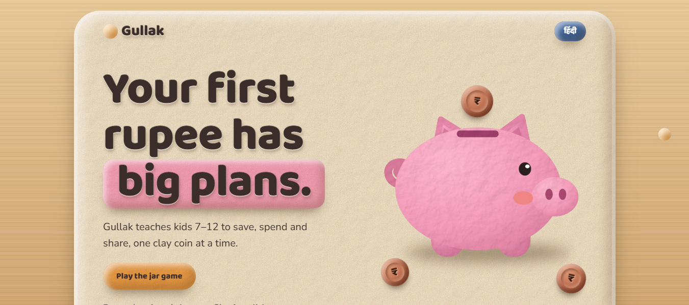
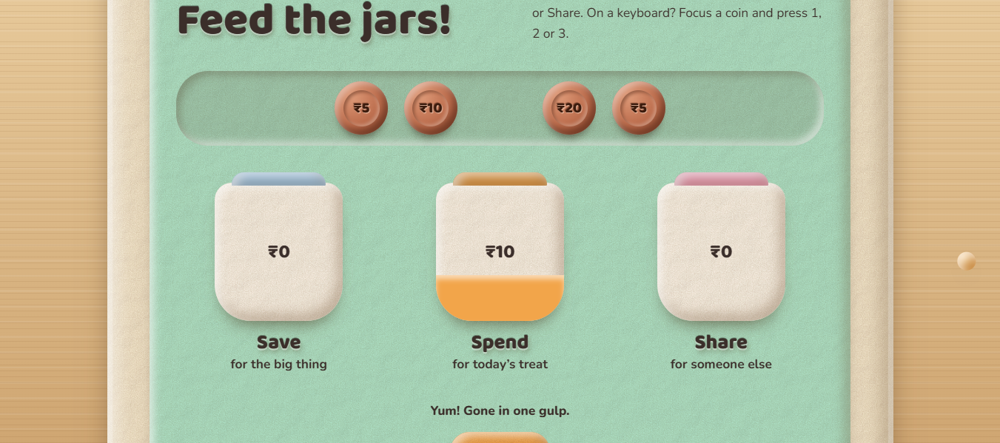
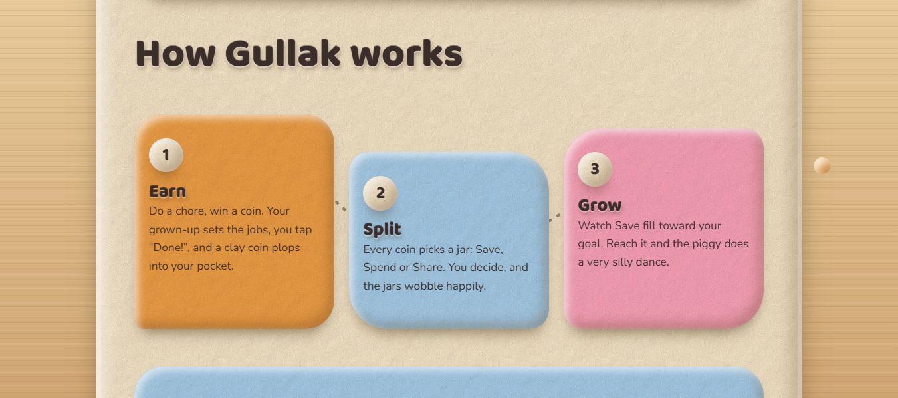
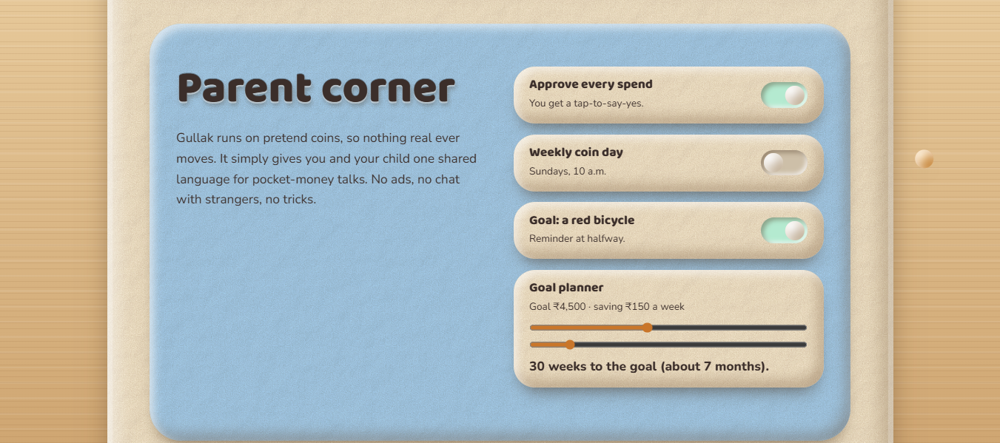
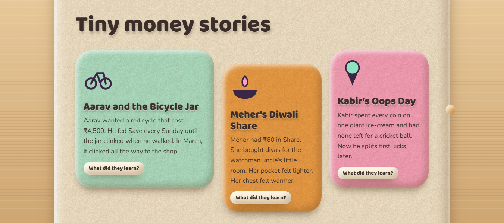
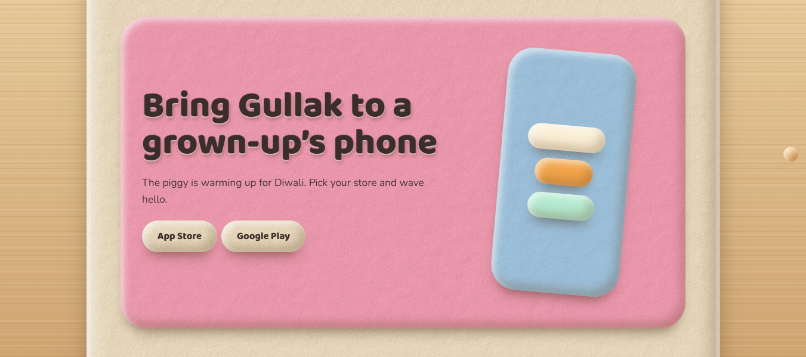

# Gullak — pocket money, played with

Gullak teaches kids aged 7–12 to **save, spend and share**, one clay coin at a time. It is a single-page, claymorphism-styled website with an interactive jar game, a parent corner and short money stories.



## Features

- **Jar game** — drag or tap coins into Save, Spend or Share jars (keyboard: focus a coin and press 1, 2 or 3).
- **How it works** — Earn, Split, Grow in three simple steps.
- **Parent corner** — toggles for spend approval, weekly coin day and goals, plus a live goal planner.
- **Tiny money stories** — short tales with a "What did they learn?" reveal.
- **English / हिंदी** language toggle.
- Pretend coins only — no real money, no ads, no chat with strangers.

## Screenshots

### Feed the jars


### How Gullak works


### Parent corner


### Tiny money stories


### Get the app


## Run locally

No build step. Open `index.html` in any modern browser.

```bash
git clone <your-repo-url>
cd gullak
open index.html   # or just double-click the file
```

An internet connection is needed for the Google Fonts (Baloo 2, Nunito).

## Project structure

```
gullak/
├── index.html
├── screenshots/
├── LICENSE
└── README.md
```

## Tech

Plain HTML, CSS and JavaScript in a single file — no frameworks or dependencies.

## License

Released under the [MIT License](LICENSE).
